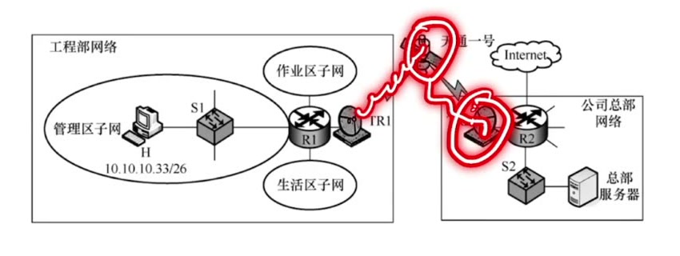

# 3.4 流量控制与可靠传输——停等、GBN、SR、滑动窗口

> [用户材料] 001 直播 P1 约189–241min 的卫星链路综合训练，以及 007 的相关真题解析。本节侧重窗口上限、利用率、有效速率和计算时延的口径。

## 一、为什么需要窗口？

发送一帧需要发送时延 $T_t=L/R$（L为帧比特数，R为线路 bit/s）。帧中的最后一位发出后，还需经过传播等过程到达接收方；接收方确认后，ACK也要经过返回传播。

停止等待（SW）每次只发送一帧，等确认后才继续；长距离、高速线路可能出现发送极短、等待很长的情况。流水式滑动窗口允许在第一帧确认返回前继续发送后续帧，减少空闲等待。

| 协议 | 发送窗口 | 接收窗口及确认特点 | 丢失/出错时的典型行为 |
|---|---|---|---|
| 停止等待 | 1 | 1，按帧确认 | 超时重传当前帧 |
| GBN（后退N帧） | n位序号时至多 $2^n-1$ | 1，累积确认；只顺序接受，可丢弃失序帧 | 超时通常重传出错/缺失帧及其后已经发送未确认的帧 |
| SR（选择重传） | 若对称收发窗口，至多 $2^{n-1}$ | 可大于1，允许缓存有效失序帧 | 选择性重传未确认的帧 |

序号只有 n 位时按模 $2^n$ 循环。一般需要窗口约束避免本轮和下一轮相同序号发生歧义，课程使用 $W_s+W_r\le2^n$ 的模型（GBN中 $W_r=1$，对称SR中两窗相等）。如果只知道一个窗口或题设另有约束，不能机械假定 SR 两窗一定相同。

## 二、信道利用率：老师的时序法

在题设忽略 ACK 自身发送、处理/排队时间、无误码丢失且发送方始终有数据的理想模型，设 RTT 是纯往返传播时间：

$$\boxed{U=\min\left(1,\frac{W_sT_t}{T_t+RTT}\right)}$$

有效平均比特速率 $S=R\times U$。分子是一个窗口最多能连续发出的数据所占时长；分母是最初一帧从开始发送到第一次ACK返回所需时间。若窗口发完前第一个ACK已经回来，就可以无间断发送，利用率最多100%。

若题目给的 RTT 已包括某些传输阶段、ACK发送或处理时延，先按题意重画时间线，不可重复计入。停止等待是 $W_s=1$ 的特例。

持续发送需要 $W_sT_t\ge T_t+RTT$，所以

$$W_{s,min}=\left\lceil\frac{T_t+RTT}{T_t}\right\rceil$$

这里向上取整，而非四舍五入；窗必须覆盖尚未返回的确认。若要求 GBN 序号位数，则令 $2^n-1\ge W_{s,min}$ 反推最小 n。

## 三、课堂卫星综合题（结合2025题思路）

```text
岛上网络/路由器──地面站 P ──卫星── 地面站 Q──ISP 路由器
                           H      H
```

课堂简化卫星为透明物理层转发，不必先收完整帧再发送；两个站各距卫星 H，光速 $c=3×10^8m/s$。信道带宽20MHz、线性信噪比31（非31dB），载荷帧长1500B=12000bit，序号6位。忽略ACK发送与处理/排队、无误码丢失。

第一步香农极限 $20M\log_2(1+31)=100Mb/s$。一帧发送时间12000/100M=0.12ms。单程传播两段，$T_p=2H/c$，往返传播 $RTT=4H/c$。

| 轨道题设 | H | 单向传播 | RTT（纯传播） | 首帧发送至ACK返回 |
|---|---:|---:|---:|---:|
| 低轨 | 550km | 3.6667ms | 7.3333ms | 7.4533ms |
| 高轨 | 36000km | 240ms | 480ms | 480.12ms |

6位序号：停等 W=1，GBN Wmax=63，对称SR Wmax=32。代入统一公式（数值按课程条件复核并适度四舍五入）：

| 协议 | 最大窗口 | 低轨有效速率 | 高轨有效速率 |
|---|---:|---:|---:|
| 停止等待 | 1 | 约1.61Mb/s | 约25.0kb/s |
| GBN | 63 | 100Mb/s（原比值超过1，封顶） | 约1.575Mb/s |
| SR（对称） | 32 | 约51.52Mb/s | 约0.800Mb/s |

利用率就是上述有效速率分别除以100Mb/s。老师明确这里只因无错假设下 GBN 允许更大的窗口才可能更快，不表示任何实际链路上 GBN 必然胜过 SR；有误码时 SR 可避免后续正确帧的无谓回退重传。

低轨不间断发送的必要窗口 $\lceil7.4533/0.12\rceil=63$，高轨为 $480.12/0.12=4001$。高轨若设计GBN，须 $2^n-1\ge4001$，最少12位序号。在题设固定带宽及信噪比时，升高卫星高度本身不改变香农容量，但增大传播往返时间，给定窗口下有效吞吐就会降低。

## 四、2025年第47题（007结课解析）



实际题面的卫星高度36000km，电磁波速度300000km/s，对称全双工每方向200kb/s；端侧是千兆以太网。忽略卫星中继、调制解调等额外开销：单向传播 $2×36000/300000=0.24s$；最大吞吐的瓶颈为卫星链路200kb/s（老师称木桶效应）。4000B 文件发到瓶颈链路的发送时延为 $4000×8/200000=0.16s$，最后一比特还需单向传播0.24s，按主要瓶颈模型最短至少约0.40s（题设忽略各层首部和以太网传播等，若另外要求计高速以太网的微小串行化/存储转发开销应按模型加入）。不能仅算发送时间当成端到端到达时间。

题目取基于GBN的数据链路协议 SLP，数据帧1500B，忽略ACK帧长度，使单向信道利用率≥80%。一帧发送时延0.06s，纯往返传播0.48s，首帧到ACK为0.54s。

$$\frac{W_s×0.06}{0.54}\ge0.8\quad\Rightarrow\quad W_s\ge\lceil7.2\rceil=8$$

GBN 接收窗1，故 $2^n\ge8+1$，序号至少4位。若改为停等，利用率 $0.06/0.54=1/9$，有效速率约22.22kb/s。

老师强调题目给陌生的 SLP 名称没有关系，认出“基于GBN”以及题设的窗口和ACK条件即可。以太网共享媒介冲突检测、802.11逐帧ACK及卫星GBN是三种不同链路机制，不可混用。

## 本节重点清单

1. 帧bit数/线路 bit/s 得发送时延；距离/传播速度得传播时延，两者不互换。
2. 6位序号不意味着64位窗口：GBN最大63、对称SR每窗最大32。
3. 利用率分母按首帧开始到 ACK 返回的时间线，分子为窗口内连续发送时间；结果大于1必须封顶。
4. 连续发送所需窗按向上取整，反求序号位数要用具体协议窗口上限。
5. 宽带长距离≠高有效吞吐；传播往返及窗口共同影响线路利用率。丢帧条件下再看 GBN 回退与 SR 选择重传代价。
