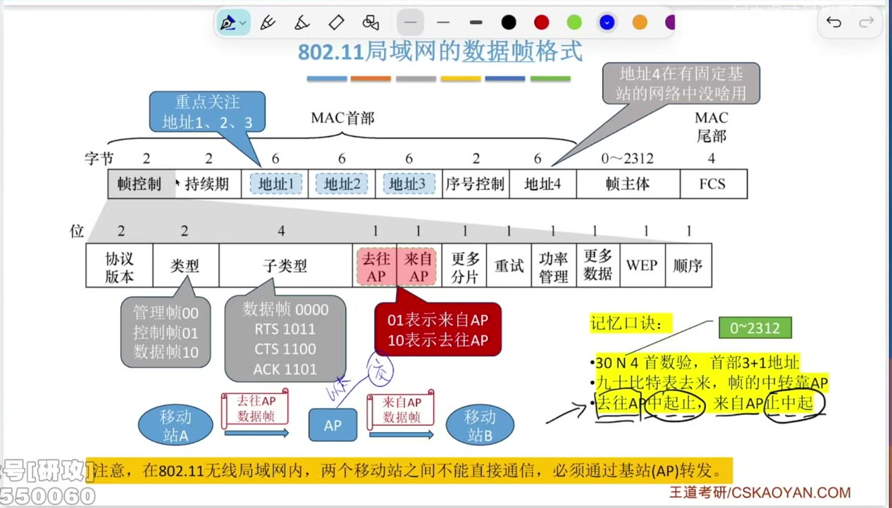

# 3.6 局域网与以太网

> [用户材料] 001 直播 P1 约60–75、150–189min，以太网帧与荒岛局域网；002 网络层拓扑与 007 结课拆报文题。老师强调以太网帧记忆口诀与物理层/链路层区分。

## 一、IEEE 802.3 / 典型以太网 MAC 帧

课中以常见以太网帧格式为例，老师口诀 **662N4，收发协数据验，N 是46到1500**：

| 字段（按图示常见格式） | 字节数 | 作用 |
|---|---:|---|
| 目的 MAC（收） | 6 | 本跳接收者的链路地址 |
| 源 MAC（发） | 6 | 本跳发送者的链路地址 |
| 类型/长度字段（协） | 2 | 典型 Ethernet II 中标识上层封装协议，如 IPv4/ARP |
| 数据及必要填充 | 46～1500 | 上层数据，达不到最小要求时填充 |
| FCS（验） | 4 | 帧校验序列 |

最短64B、最长1518B（未计 VLAN 标记等额外格式）。题中若另给前导码、帧开始定界符等，按请求的物理传输时间计入；不要把前导码无条件算到64B标准 MAC 帧内。**头部14B，尾部4B，总开销18B**；拆字节流时 IP 或 ARP 通常从前14B 后开始，FCS 在帧末，不应把18B都当首部跳过。

课例要求最短帧满足共享半双工 CSMA/CD 争用期（详见3.5）。最大数据字段1500B也是典型 IP 层 MTU 的来源；超过链路可承载的 IP 数据报时，可能按协议/题给条件分片或采取相应处理（详见4.2）。

### MAC地址

MAC 地址常为48bit，即6B、12个十六进制数字。全1 `FF:FF:FF:FF:FF:FF` 为以太网广播地址。链路层单播一般只让目的匹配的主机接受帧；同广播域中的普通广播可被各节点接收。实际多播、VLAN等条件按题设。

## 二、物理连成局域网，不等于已经连接 Internet

在荒岛题中，即使没有任何路由器，只要主机与集线器/交换机形成同一局域网，各主机可以手动配置同一子网内不同的IP，例如 `192.168.1.x/24`，主机号不能使用普通子网的全0或全1。网内直接通信不必先拥有有效的默认网关，更不需要公网IP。

加入路由器后可互连不同 IP 网络并使用合适的下一跳转发；若接入互联网还涉及 ISP、地址分配及可能的 NAT。默认网关通常是本机所在网络上的路由器接口IP，不是交换机的任意端口编号。

## 三、广播域、冲突域、全双工

| 局域网设备 | 冲突域 | 广播域（无其他划分条件） |
|---|---|---|
| 集线器 | 多端口共享一个冲突域 | 同一广播域 |
| 普通交换机 | 可分割冲突域，每个交换端口所接网段独立；全双工点到点连接通常无碰撞 | 同VLAN/平面二层网络仍可一个广播域 |
| 路由器 | 分隔所连链路/网络 | 普通链路广播不会跨路由器泛洪 |

课堂混合拓扑：A、B、C 各连交换机1/2/3端口；D、E先接Hub再连交换机4端口。冲突域数为4，而不是5（D/E/端口4共享同一个），单一二层网络下广播域为1。若问哪些接口需要CSMA/CD，D、E以及交换机连接集线器的半双工端口4都需要；A/B/C 与交换机的全双工点到点链路不需要。交换机是否转送帧按其学习与查表规则（3.8）。

## 四、802.11 无线帧与 AP 的二层转换（P5重点）

基础设施模式中移动站通常通过无线AP转发，AP有无线侧和有线侧，功能可类比链路层桥接。802.11 帧与 802.3/常见以太网帧格式不一样，但 AP 的二层中转不代表每次把自身地址当原始发件人。

课上口诀：**30 N 4，首数验，首部3+1地址；去往AP中起止，来自AP止中起。** 图中完整列出帧控制2B、持续期2B、地址1～3各6B、序号控制2B、可选地址4（6B）、帧主体0～2312B（教材图示口径）、FCS4B。基础设施三地址格式并不使用第四地址，基础首部24B；带第四地址的基本首部30B。实际802.11帧型及附加字段按题给；与以太网互连常按其MTU条件设计。

| 方向（课堂基础设施三地址模型） | To DS/From DS | Addr1 | Addr2 | Addr3 |
|---|---|---|---|---|
| 移动站→AP，去往AP “中起止” | 1/0 | 中间AP无线侧MAC（当前接收者） | 起点移动站MAC | 本次链路数据最终目的MAC |
| AP→移动站，来自AP “止中起” | 0/1 | 终点移动站MAC | 中间AP无线侧MAC（当前发送者） | 本次链路数据原始发送者MAC |

| 例子 | 802.11帧三地址 | 与以太网连接时的变化 |
|---|---|---|
| X→有线主机A | `(AP,X,A)` | 转成以太网：目的A、源X |
| 有线A→X | `(X,AP,A)` | 原以太网：目的X、源A |
| X→无线Y | `(AP,X,Y)`，再由AP发送 `(Y,AP,X)` | 仍保留链路原始发件人/收件人的意义 |

这里“止”不等于任意互联网目标的MAC：若无线 X `192.168.1.80/24` 向异网 `200.1.1.4` 发送，首跳逻辑帧目的为默认网关 `192.168.1.6` 的MAC（课中 `22:11:11:11:11:FF`）。无线三地址 `(AP,X,网关)` 转为以太网时应是源X、目的网关；IP目的仍是外网服务器。AP不是自动在每跳改IP的路由器。

2022年第47题，取MAC尾部简记 AP=C1、H4=D1、H5=E1。H4 第一次 DHCP Discover 承载广播IP，其802.11去往AP地址为 `(C1,D1,FF…FF)`；AP 转成以太广播（目的FF…FF、源D1），交换机向DHCP服务器和同网路由接口转发。无线广播由AP发时三地址为 `(FF…FF,C1,D1)`。若H4单播H5，H5收到的是 `(E1,C1,D1)`。本课给802.11的帧主体最小0B，因此40B的IP包封装无线帧不需按以太网46B填充；跨不同链路时看实际帧格式。

## 重点清单

- 662N4，6目的、6源、2协议类型、N数据、4FCS；64～1518B，典型MTU=1500B。
- 拆二进制报文时 MAC 帧首部14B，FCS在最后。
- 交换机隔离冲突域不等于无条件隔离广播域；Hub两个结点共享介质时交换机的接入端口也要按半双工规则运行。
- 同子网可以在无网关的局域网直接通信；跨网才需要路由。
- 三地址口诀：去往AP中起止，来自AP止中起；“止”是本次二层交付的目标，异网时是下一跳网关。AP二层中转不篡改原始链路源/目的。
