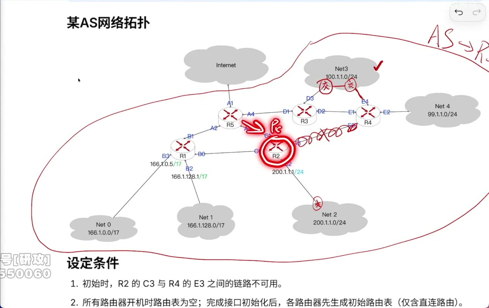
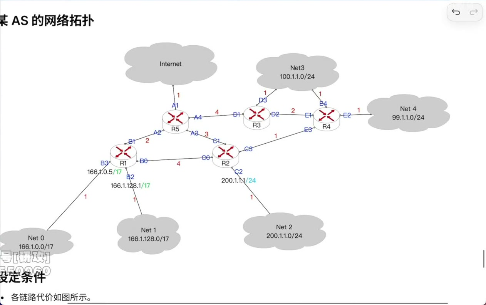

# 4.4 路由算法与路由协议——RIP、OSPF、BGP

> [用户材料] 004 P4 约2:32–3:48，005的BGP简提和007结课解析2024年第47题。老师强调会分析好消息/坏消息传播、搭建拓扑、读选路顺序，而不是孤立记住三种协议名称。

## 一、自治系统与转发表

互联网由多个自治系统 AS 互连，每个 AS 可在内部采用自己的路由方案。课中将 RIP、OSPF 归于 AS 内部路由选择，BGP 用于 AS 之间可达性与策略路由，也可通过 iBGP 在本 AS 传播外部路由信息。

路由表类似保存多种路由基础信息的原材料（前缀、度量、来源、下一跳等），转发表用于实际分组转发，按已选择的路由组织目的前缀→下一跳/接口。云朵若标为某一个具体子网，多个接口连同一云可理解为同一局域网（背后可能是交换机）；不要一看到云就认为是不可见的另一个路由器或另一个AS。

| 协议 | 范围和思路 | 承载方式 | 主要考点 |
|---|---|---|---|
| RIP | IGP，距离向量 | UDP520 | 邻居交换周期、跳数、收敛、16不可达 |
| OSPF | IGP，链路状态 | 直接IP（Protocol89） | LSA洪泛、统一拓扑、Dijkstra、累加代价 |
| BGP | AS间/AS内传播外部路由，路径向量与策略 | TCP179 | AS_PATH、eBGP/iBGP、选路优先级与四消息 |

## 二、RIP：距离向量（课程简化同步模型）

路由器最开始知道自己的直连网络（本课程取距离1），收到邻居通告 `d` 时，考虑通过邻居到该网络的候选距离 `d+1`。比较候选距离与当前路由，选择合适的下一跳；若旧路由也经该邻居，则需按其最新通告更新该路径状态，不能只收好消息而忽略旧路径变差。RIP 把16作为不可达，普通可达路径度量至多15。

实际 RIP 可有触发更新、水平分割、毒性逆转等机制；强化题为便于手算可能明确忽略它们、每30秒同步交换一次。题设优先，不能把真实优化加到一份简化同步题中。

### 1. 好消息传播 = BFS 分层扩展

假定 t=0 所有路由器已知直连且立即向邻居交换信息，此后每30s整轮同步交换。每一轮好消息最多沿路由器邻接关系推进一层。若最远路由器距广告者 m 条路由器邻接边，且首次交换确在t=0，则它在第m轮 t=(m−1)×30s知晓。是否每轮立即再转发、首轮何时发生，都要读清参数。

课堂 R1–R5 练习：R1 与R2、R5相连，R2与R5相连，R5与R3相连，R3到R4（另共享Net3），R2–R4最初不可用。R4一侧新增网络消息 t0到R3，t30到R5，t60到R1/R2，不能再加一轮成90s。边界R5有默认路由0/0，本题也将其直达度量设1。等价最短下一跳在题设需要时都保留。

新增 R2–R4 链路时两端可立即交换较近路径，R2学到去Net3/4的新短路线，R4学到去Net0/1/2的新短路线，再于后续交换通知其余邻居。转发结果取决于实际图的路径距离而非设备名称顺序。

### 2. 坏消息慢：计数到无穷（老师类比“踢皮球”）

当某条直连网络断开时，邻居可能还保留原先经故障路由器抵达该网络的旧信息。故障路由器误以为可以绕邻居到达，邻居又从故障路由器听到错误可达信息，形成逻辑循环，度量逐步增加直至16。不同步和具体优化会影响真实行为。

典型2016年第37题课堂三角形中 R3 直接连网络却断开，R3 从邻居旧距离2误得到候选3，再通告R2；R2 同一轮听到 R3 距离3（候选4）和 R1 原有距离2（候选3），故选3（不是直接16，也不是单看R3选4）。画表明确每轮读取的究竟是上一轮数据还是已允许的新信息。

### 3. 2024年第47题的收敛计算

AS1 图中 R11–R12–R13、R11–R14、R14–R15–R16、R13–R15 相连。 `210.2.3.0/24` 直连R14，`210.2.4.0/24` 直连R16；t=0 立即互换、以后30s一次。

| 网络 | t=0首次传播 | t=30 | t=60 | 收敛至全部 |
|---|---|---|---|---|
| R14 的210.2.3.0/24 | R11,R15知晓 | R12,R13,R16知晓 | — | 30s |
| R16 的210.2.4.0/24 | R15知晓 | R14,R13知晓 | R11,R12知晓 | 60s |

AS4 若可能超过20个路由器的可达路径，不能使用度量16不可达这一受限模型充分覆盖，题目在RIP/OSPF中应选OSPF。TTL与该RIP度量及OSPF权值不要混淆：若最多实际经15台路由器，初始TTL至少16。

## 三、OSPF：链路状态与 Dijkstra

老师以“人人献出一点爱，就组成完整邻接表”帮助记忆。每台路由器通过本地探测获得邻居和连接代价，将**自己的局部链路状态信息**用 LSA 向相应范围洪泛；同一区域路由器获得相应的一致拓扑信息/LSDB后，各自以自己为源运行Dijkstra，求到各目标网络的最小代价路径和下一跳。

与RIP区别：RIP根据邻居通告的距离向量比较候选；OSPF有更完整的图，采用边权/代价，而非单纯最少路由器数。拓扑变化后通告更新的链路状态并重新计算，通常较快传递坏消息，不像简化距离向量反复互相抬高距离。大型AS可分区域控制洪泛范围与开销。

课中使用同一组R1–R5图，权值R1–R2=4、R1–R5=2、R2–R5=3、R5–R3=4、R3–R4=2，所给直连网络代价1，R2–R4最初不存在。R1 到Net3最短路径可经R5→R3，总成本2+4+1=7，从R1连R5的B1出。共享Net3 的有关OSPF接口被题设为 passive，不建立相互邻接但仍通告其直连网络；这是此题拓扑建模规则，而非禁用用户数据转发。新增R2–R4且代价1，两端更新LSA、洪泛后各自重算；直连断链路时由相邻路由器更新链路状态。

**老师重点陷阱：** 若某个数据包实际由R1→R2→R4三台路由器转发到目标网络，初始TTL10变成7，与路径边权4、1等无关，不能按最短路径成本递减TTL。

## 四、BGP（老师考前口诀：“一偏二短三土四老”）

BGP基于TCP，在AS之间通告可达网络前缀、路径和相关属性。eBGP用于不同AS间的对等会话，iBGP在同AS内传播外部路由信息；课程典型iBGP同AS对等体可建立逻辑会话，不必物理邻接，教材模型可能使用全互连，而复杂真实网络还可用其他组织方式。

| 消息 | 作用 |
|---|---|
| OPEN | 建立BGP会话并交换必要参数 |
| UPDATE | 公告新的可达前缀/路径或撤销路由 |
| KEEPALIVE | 保持会话活跃 |
| NOTIFICATION | 报告错误、可能终止会话 |

课中2024年题采用简化选路规则，老师现场口诀：

1. **一偏**：本地偏好（LOCAL_PREF）高者优先，体现AS策略。
2. **二短**：AS路径较短者优先（不是每跳链路物理时延最短）。
3. **三土**：热土豆（Hot Potato），到候选出口的本AS内部代价低者优先，尽快将包交给其他AS。
4. **四老**：前面相同再按较小BGP标识符等给定规则打破平局，老师用“听老员工、工号小”助记。

完整真实BGP决策通常含更多属性/规则；这里是课堂考题使用的优先顺序，不应当作任何设备实现的完整规范。

### 2024年第47题选择出口

AS4的R44向AS1的R13通告外部路由属于eBGP，可使用UPDATE；R13向同AS1的R14/R15传播属于iBGP。给定目标 `136.5.16.0/20`，候选出口路径为：R11通告AS2、AS8、AS19（三个AS）；R12通告AS3、AS7、AS11、AS19（四个）；R13通告AS4、AS10、AS19（三个）。本地偏好等在题给相等时，先排除四跳R12，再比较内部到R11/R13的代价。题图 R14 走R11较近、R15走R13较近；若变式R12也是边界，不因它就在自己机器上就优先于更短AS路径，仍按前几级逐层判断。到两个三跳出口等距的情况下，需按题给标识符决定，未给就不能擅自选一个。

## 考前重点

- RIP 直连与邻居度量、收敛轮次起点；好消息BFS，坏消息计数到16（题设无防环优化时）。
- OSPF 本地邻接→LSA洪泛→LSDB全图→Dijkstra；TTL不等于路径权值。
- BGP UDP/TCP别记反，eBGP/iBGP、四类消息，按一偏二短三土四老逐级筛选。
- 路由可达性的策略、距离向量、链路状态是不同算法；转发时仍根据结果表按目的IP查前缀，而不是每个包运行整个Dijkstra。
